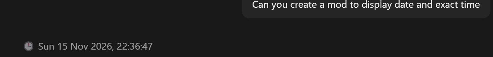

# message-time



A Claude Code mod that shows the full date and exact time under every chat
message, for example `🕒 Sun 15 Nov 2026, 14:32:07`. Your own messages get the
time on the right, Claude's replies under each text block.

The app's own relative label ("2 days ago") stays as it is; this adds the exact
time beside the message. Times for earlier messages in a session are read from
the session's saved history when the session starts; new messages are timed as
they arrive.

## Install

At the prompt of a Claude Code terminal session:

```
/plugin install message-time --marketplace arunmuthuganesh/message-time
```

Answer `y` to add the marketplace, then press Enter to pick the user scope.

From a shell:

```
claude plugin install message-time --marketplace arunmuthuganesh/message-time
```

In the desktop app, where `/plugin` does not run: click + next to the prompt
box, then Plugins, Add marketplace with `arunmuthuganesh/message-time`, then Add plugin.

## Limits

- Session history files over 4 MB are not read, so very long sessions show
  times only for messages sent after the session starts.
- Times are kept in the mod's own store (up to 20,000 messages).

## License

MIT
